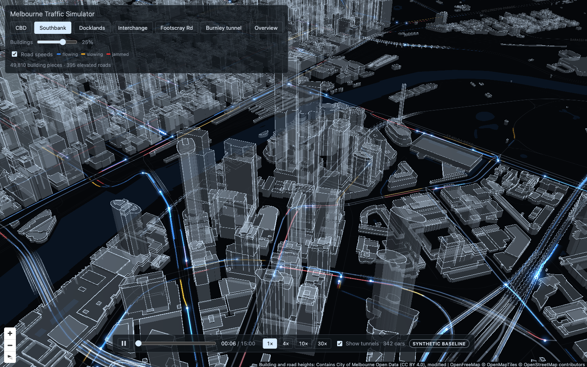

# Melbourne Traffic Simulator

### Explore Melbourne's streets, structures, and simulated traffic in 3D.

A computer science project combining open geospatial data, SUMO traffic simulation, and an interactive browser visualisation of Melbourne's CBD, Southbank, and Docklands.

Follow vehicles through the city, inspect bridges and stacked interchanges, reveal underground tunnel traffic, and explore simulated road speeds against a detailed urban environment.



**The included demo is ready to run.** It combines real Melbourne geography with a synthetic baseline traffic scenario. Prepared city data and vehicle paths are included; the raw downloads and a running SUMO process are not required to view it.

## Explore the demo

- **A detailed 3D city:** translucent building pieces, stacked structures, rooflines, and adjustable building opacity.
- **Moving traffic:** glowing vehicle heads and trails, a seekable timeline, and playback speeds from 1× to 30×.
- **Road-speed overlays:** blue, amber, and red indicate simulated speeds relative to the road's speed limit. Roads without observations in the current minute remain uncoloured.
- **Bridges, cuttings, and tunnels:** elevated roads retain their height relationships, while an X-ray view reveals underground movements.
- **Camera presets:** jump between the CBD, Southbank, Docklands, the freeway interchange, Footscray Road, the Burnley Tunnel, and an overview.

| Included baseline | Value |
| --- | --- |
| Replay duration | 15 minutes |
| Distinct vehicles across the replay | 1,459 |
| Rendered building pieces | 49,810 |
| Traffic demand | Synthetic, moderate density |
| Simulation engine | SUMO 1.28.0 |
| Random seed | 42 |

A building can contain several rendered pieces. Vehicle totals cover the complete replay, rather than the number visible at one moment. The baseline is a simulation demonstration, not a measured off-peak period.

## Run locally

Use **Node.js 22**, as specified by `.nvmrc` and the package engines. pnpm is pinned by the root `packageManager` field and is available through Corepack.

From the repository root:

```bash
nvm use
corepack enable
pnpm install --frozen-lockfile
pnpm dev
```

If Node 22 is not installed through nvm yet, run `nvm install` first. Open the local URL printed in the terminal, normally **http://localhost:5173**. A modern WebGL-capable browser and internet access for the background map tiles and fonts are required. Press **Ctrl+C** to stop the server.

The browser demo does not require Python, SUMO, or the raw source downloads.

## Engineering the simulator

```text
Open geospatial and transport data
                ↓
Python processing, provenance, and validation
                ↓
Prepared city geometry and SUMO network
                ↓
SUMO simulation → vehicle paths and road-speed exports
                ↓
React + TypeScript + deck.gl + MapLibre
```

**Geospatial processing.** OpenStreetMap roads and buildings are combined with City of Melbourne building and elevation datasets. Processing handles stacked building sections, clearances beneath structures, bridge decks, cuttings, and tunnels. Provenance fields distinguish measured, sourced, and estimated values.

**Simulation.** The SUMO network models left-hand traffic, junction movements, turn restrictions, lane access, and signals. Export processing turns simulation results into timestamped 3D vehicle paths and per-road speed data. The repository also retains traffic-count processing and calibration modules from the wider project; the public demo bundles only the baseline replay.

**Rendering.** MapLibre and deck.gl share a graphics context and depth buffer. Playback updates traffic layers without rerendering the React interface every frame. On-demand frame scheduling lets the render loop sleep when playback is paused and the scene has settled.

## Project structure

| Path | Purpose |
| --- | --- |
| `web/` | Interface, map, rendering layers, playback, and browser tests |
| `pipeline/` | Geospatial and transport-data processing and verification |
| `data/processed/` | Prepared city datasets and verification reports |
| `sim/` | Network construction, simulation, calibration, and exported results |
| `tests/contracts/` | Schema and consistency checks across the components |
| `docs/checkpoint.md` | Release scope, measured results, and known limitations |
| `data/SOURCES.md` | Dataset provenance, licences, and attribution |

Raw datasets, source signal-sheet images, local simulation intermediates, and the larger morning-peak replay are intentionally excluded. The committed outputs are the interfaces used by the included demo.

## Checks and production build

For the full Python and web checks, install [uv](https://docs.astral.sh/uv/) and use the project's Python 3.12 environment:

```bash
uv sync
pnpm check
pnpm -C web e2e
```

`pnpm check` runs Python lint, formatting checks and tests, followed by web lint, TypeScript checking, and unit tests. Browser tests cover loading, playback, camera controls, fixture handling, and visible map attribution. Tests for intentionally excluded inputs skip when those inputs are unavailable.

Build and preview the static application with:

```bash
pnpm -C web build
pnpm -C web preview
```

## Current scope and limitations

This release focuses on passenger-car simulation and precomputed playback. It does not include live traffic feeds, prediction, or interactive planning controls. Trams, buses, pedestrians, and cyclists are not simulated, and some geometry heights are estimates.

The baseline's recorded geometry check flags **4 of 234,054 ground samples (approximately 0.0017%)** inside two building footprints. Slight footprint/carriageway overlap or straight-line playback interpolation between recorded samples may account for these brief corner intersections; the cause is not conclusively established. The report is retained unchanged, and not every geometry diagnostic passes.

See the [technical checkpoint](docs/checkpoint.md) for the numerical results, the known height-report inconsistency, and the limitations of the wider calibration experiments.

## Licence and attribution

Source-available for evaluation; all rights reserved — see LICENSE.md.

Data files retain their own licences as recorded in [data/SOURCES.md](data/SOURCES.md). The code restrictions do not relicense the data.

The committed OpenStreetMap-derived geospatial datasets are licensed under **ODbL 1.0**. City of Melbourne and Victorian transport datasets retain their applicable **CC BY** terms and attribution requirements.

Map credits remain visible in the application: **OpenFreeMap, OpenMapTiles, and © OpenStreetMap contributors**, alongside the City of Melbourne height-data credit.
